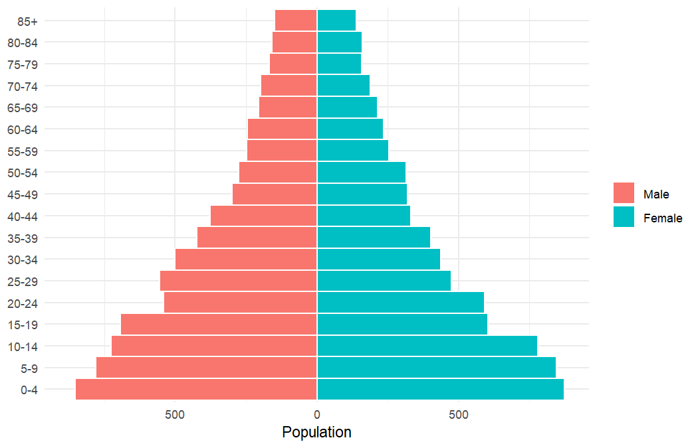
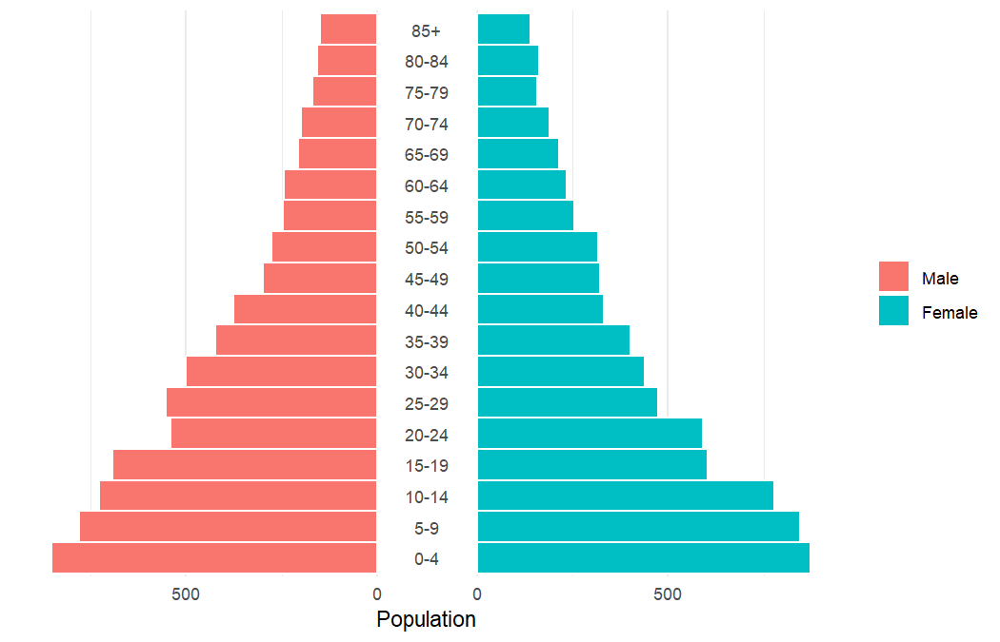
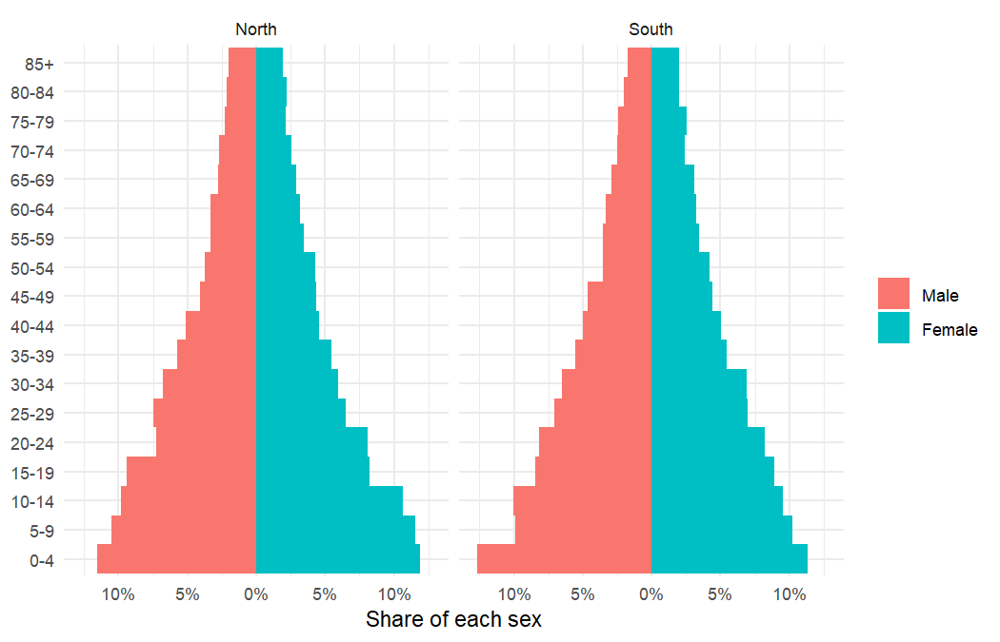
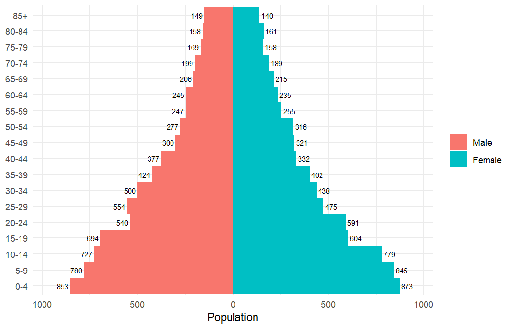
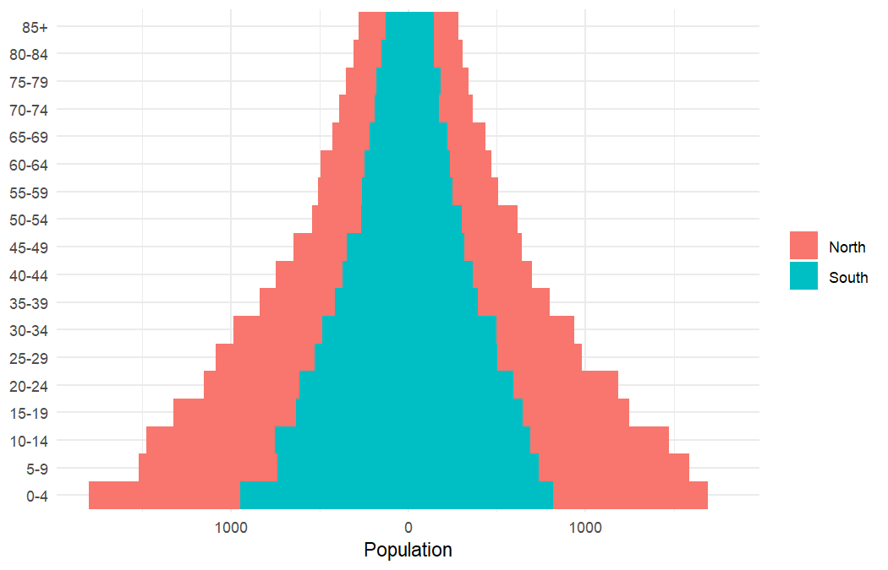

<!-- README.md is generated from README.Rmd. Please edit that file -->

# ggpyramid

<!-- badges: start -->

[](https://lifecycle.r-lib.org/articles/stages.html#experimental)
[](https://github.com/matanhakim/ggpyramid/actions/workflows/R-CMD-check.yaml)
<!-- badges: end -->

ggpyramid is a [ggplot2](https://ggplot2.tidyverse.org) extension for
building population pyramids: back-to-back bar charts of a population by
age group and sex. A pyramid is one more layer in an ordinary ggplot, so
scales, facets, themes and further layers work as they do anywhere else
in ggplot2. The package is in early development.

## Installation

You can install the development version of ggpyramid from
[GitHub](https://github.com/matanhakim/ggpyramid) with:

``` r
# install.packages("pak")
pak::pak("matanhakim/ggpyramid")
```

## Example

`geom_pyramid()` draws the bars. It sums a value when one is mapped, as
here, and counts rows when it is not, so it accepts both aggregated data
and individual records. The example data are synthetic.

``` r
library(ggplot2)
library(ggpyramid)

ages <- c(paste0(seq(0, 80, 5), "-", seq(4, 84, 5)), "85+")
set.seed(1)
pop <- expand.grid(
  age = factor(ages, ages),
  sex = factor(c("Male", "Female"), c("Male", "Female")),
  region = c("North", "South")
)
pop$n <- round(1000 * exp(-as.integer(pop$age) / 9) * runif(nrow(pop), 0.9, 1.1))

ggplot(subset(pop, region == "North"), aes(x = n, y = age, fill = sex)) +
  geom_pyramid(width = 1, colour = "white") +
  coord_pyramid() +
  labs(x = "Population", y = NULL, fill = NULL) +
  theme_minimal()
```



`coord_pyramid()` takes care of the axes. It labels both sides without a
minus sign and gives them the same range, and it can move the age axis
to the right, to both sides, or into a gap in the centre of the pyramid:

``` r
ggplot(subset(pop, region == "North"), aes(x = n, y = age, fill = sex)) +
  geom_pyramid(width = 1, colour = "white") +
  coord_pyramid(age_axis = "centre") +
  labs(x = "Population", y = NULL, fill = NULL) +
  theme_minimal() +
  theme(panel.grid.major.y = element_blank())
```



`denominator` turns the bars into proportions, of the whole panel or of
each side, and each facet gets its own denominator.

``` r
ggplot(pop, aes(x = n, y = age, fill = sex)) +
  geom_pyramid(denominator = "side", width = 1) +
  scale_x_continuous(labels = scales::label_percent()) +
  coord_pyramid() +
  facet_wrap(vars(region)) +
  labs(x = "Share of each sex", y = NULL, fill = NULL) +
  theme_minimal()
```



`position_pyramid()` does the mirroring, so any other layer can join the
pyramid with `position = "pyramid"`:

``` r
ggplot(subset(pop, region == "North"), aes(x = n, y = age, fill = sex)) +
  geom_pyramid(width = 1) +
  geom_text(aes(label = n, hjust = -0.15), position = "pyramid", size = 2.5) +
  scale_x_continuous(expand = expansion(mult = 0.1)) +
  coord_pyramid() +
  labs(x = "Population", y = NULL, fill = NULL) +
  theme_minimal()
```



The side of each bar comes from `fill` unless `side` is mapped. Mapping
it separately stacks subgroups within each side:

``` r
ggplot(pop, aes(x = n, y = age, fill = region, side = sex)) +
  geom_pyramid(width = 1) +
  coord_pyramid() +
  labs(x = "Population", y = NULL, fill = NULL) +
  theme_minimal()
```


