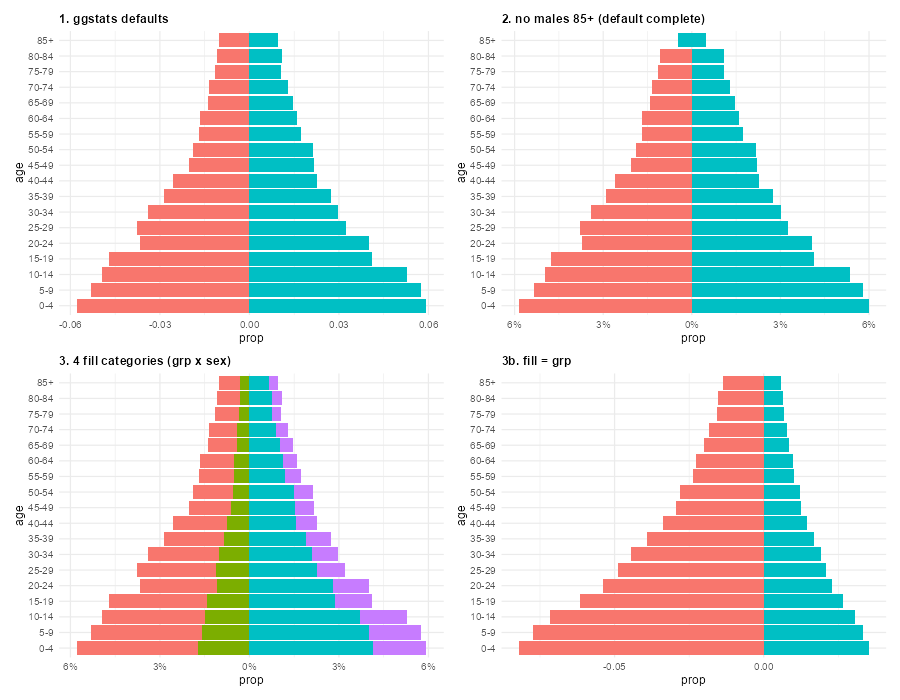
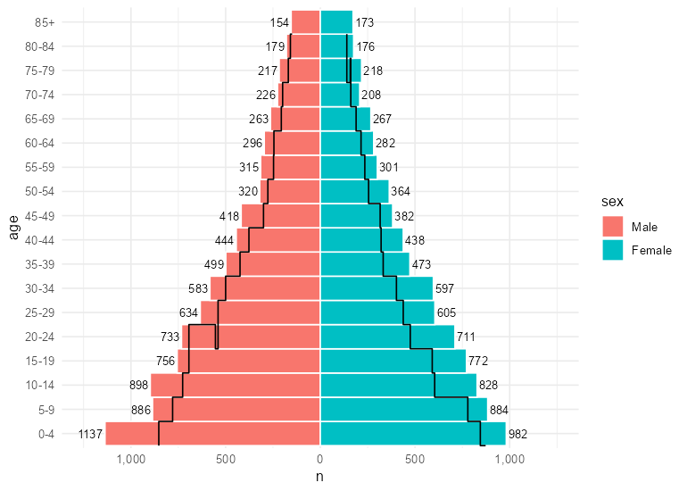
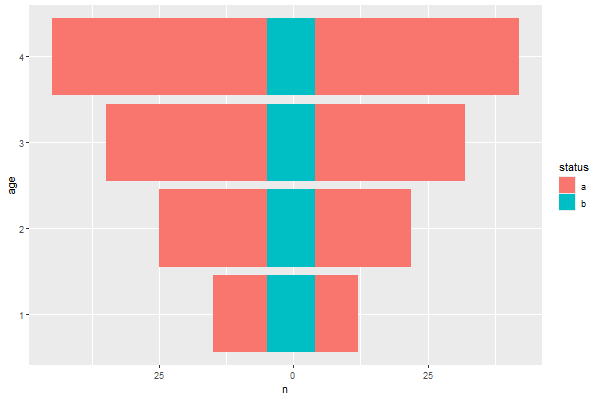
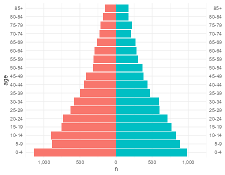
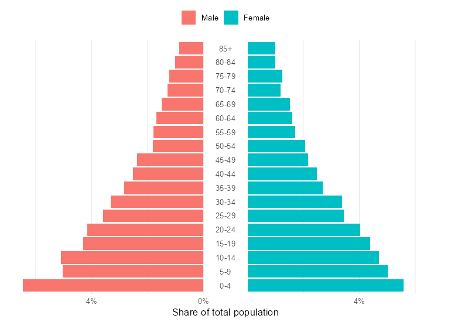
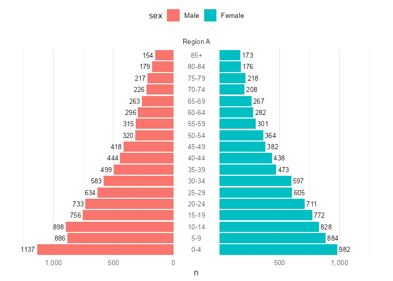
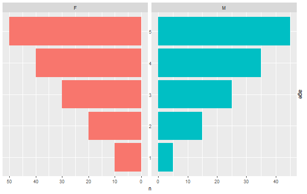

<div dir="rtl">

# ggpyramid: מחקר רקע וחלופות תכנון

נכתב ב-22.10.2026, לפני כתיבת קוד החבילה. המסמך מתעד את המחקר; ההחלטות עצמן מתקבלות בשיחה ונרשמות בסעיף 8 אחרי שהתקבלו.

## תקציר

המחקר נשען על ארבעה מקורות: קוד המקור של חבילות R קיימות, הדרכות ותקני עיצוב של סוכנויות סטטיסטיקה, הקוד של ggplot2 4.0.2 המותקן, ואבות-טיפוס שבניתי כדי לבדוק היתכנות. רוב הכלים הקיימים הם פונקציות עוטפות שמחזירות תרשים שקשה לשנות אחר כך. הכלי היחיד שבנוי כשכבה אמיתית של ggplot2 הוא `geom_pyramid()` של ggstats, שנוסף לחבילה כחלק ממשפחת תרשימי Likert. הוא קובע את הצד לפי מיקום הקטגוריה בערימה, ולכן קטגוריה שחסרה בגיל אחד מזיזה את העמודה בלי אזהרה, ומשאיר למשתמש את ציר הגיל ואת שכבות ההשוואה. אבות-הטיפוס מראים ש-Position ב-ggplot2 4.0 מספיק לשיקוף הצדדים ולערימה בתוך כל צד. הם מראים גם שמערכת קואורדינטות ייעודית (Coord) יכולה להוסיף פער במרכז, תוויות גיל בתוכו, תוויות בערך מוחלט וגבולות סימטריים. ההמלצה היא חלופה ד בסעיף 6, שמשלבת את שני המנגנונים.

## 1. הכלים הקיימים

| כלי | גישה | מצב | רישיון | חולשה מרכזית |
|---|---|---|---|---|
| `apyramid::age_pyramid()` | פונקציה עוטפת: ספירה, היפוך סימן בנתונים, `coord_flip()` | CRAN 0.1.3 (2023), תיקוני תלויות בלבד מאז 2020 | GPL-3 | כל scale או coord שמוסיפים מוחק את התוויות והגבולות שלה |
| `ggstats::geom_pyramid()` | `geom_bar` עם `StatPropProp` ו-`position_diverging` | CRAN 0.14.0 (2.9.2026), פעילה, דורשת ggplot2 4.0 | GPL (>= 3) | הצד נקבע לפי מיקום הקטגוריה בסדר ה-fill, וקטגוריה חסרה בגיל אחד מזיזה את העמודה (סעיף 1א) |
| `ggcharts::pyramid_chart()` | שני תרשימים מחוברים ב-patchwork | CRAN 0.2.1 (2020), ללא עדכון מאז 2021 | MIT | התוצאה אינה אובייקט ggplot יחיד |
| `ggpol::facet_share()` | Facet שמשכתב את ה-grobs של הצירים | הוסרה מ-CRAN ב-4.12.2025 | MIT | נכשלת תחת ggplot2 4.0.2 |
| `popPyramid` | פונקציה עוטפת; בגרסת GitHub מ-2025 יש `GeomPyramid` שהופך סימן ב-`setup_data` | CRAN 0.1.1 (2021) | GPL-3 | הצד נקבע לפי סדר הופעה בנתונים |
| `reconhub/ggpyramid`, `javiereliomedina/ggpyramid`, `musajajorge/ggPyramid` | פונקציות עוטפות עם שתי שכבות `geom_col` ו-`coord_flip()` | נטושות, 0 כוכבים | MIT (javiereliomedina), GPL-3 (musajajorge), תבנית לא ממולאת (reconhub) | צמצום הנתונים בתוך הפונקציה, צד לפי התאמת מחרוזת |

השם `ggpyramid` פנוי ב-CRAN, ושלושת המאגרים בעלי השם הזה ב-GitHub נטושים, כך שאין התנגשות עם פרויקט פעיל.

אותן טעויות חוזרות בכמה מהכלים. `coord_flip()` הופך את שמות הצירים, ולכן `labs(x = ...)` משנה את הציר הלא נכון. ערכים שהסימן שלהם הוחלף לפני ggplot מופיעים כמספרים שליליים בכל `geom_text` שהמשתמש מוסיף. הצד השמאלי נבחר לפי סדר הופעה או לפי התאמת מחרוזת. בתוך הפונקציה הנתונים מצטמצמים לגיל, מין וערך, כך שאי אפשר לפצל לפי אזור או שנה. הגבולות מחושבים פעם אחת מחוץ ל-scale ונשברים כשמוסיפים שכבה. מנגד, כמה רעיונות שווה לאמץ: `drop = FALSE` על ציר הגיל כדי שקבוצות ריקות יישארו, שנתות סימטריות שנבנות מהמקסימום, תוויות בערך מוחלט עם מפריד אלפים, `width = 1`, קו אפס ותוויות ערך בתוך העמודה או מחוצה לה.

הקוד של apyramid, ggstats ו-popPyramid מוגן ב-GPL. ggpyramid מופצת ב-MIT, ולכן מהחבילות האלה לוקחים רעיונות בלבד.

### 1א. ggstats לעומת חלופה ד, בבדיקה בפועל

ggstats בנויה סביב Position, בדומה לחלופה ג. `geom_pyramid()` שלה הוא `geom_bar()` עם `stat_prop()`, שמחשב אחוז מכלל האוכלוסייה, ועם `position_diverging()`. ה-Position הזה מערים בכל קבוצת גיל את כל השורות לפי סדר רמות ה-fill, ואז מזיז את הערימה כך שמחצית מהשורות נמצאות משמאל לאפס (`cutoff = nrow(df) / 2`). הצד של כל קטגוריה נקבע לפי מיקומה בערימה ולפי מספר השורות שנמצאו באותו גיל. ההבדל מחלופה ד הוא בהגדרת הצד: אצלנו הצד הוא משתנה מפורש, וה-Position מחליף סימן לכל שורה ששייכת לצד השמאלי בלי קשר לכמה שורות יש באותו גיל. הרצתי את ggstats 0.14.0 על אותם נתונים (`dev/spikes/ggstats_comparison.R`):



**תרשים 7.** ארבעה מקרים ב-ggstats 0.14.0.

- **בהגדרות ברירת המחדל** (חלון 1) הערכים הם אחוז מכלל האוכלוסייה. התוויות בצד שמאל שליליות (`-0.06`) כל עוד לא מוסיפים `label_percent_abs()`, והגבולות לא סימטריים (מ-`-0.0638` עד `0.0651`) כל עוד לא מוסיפים `symmetric_limits()`.
- **כשחסרה שורה אחת**, למשל אין גברים בני `85+` (חלון 2), העמודה היחידה שנשארה בגיל הזה ממורכזת סביב האפס, ומחצית מהנשים בגיל הזה מצוירות בצד הגברים. זה קורה בלי שום אזהרה. הפרמטר `complete = "fill"` מונע את זה, אבל ברירת המחדל של `geom_pyramid()` היא `complete = NULL`. בנתונים ברמת הפרט, כמו ביישוב קטן או בגיל `95+`, זה מקרה שכיח.
- **ב-ggstats הצד וה-fill הם אותו משתנה.** כדי לצבוע תת-קבוצות בתוך כל מין צריך `fill = interaction(grp, sex)` (חלון 3), שעובד רק כשבכל גיל יש מספר זוגי של קטגוריות שמתחלקות שווה בשווה. אם צובעים לפי תת-קבוצה בלבד (חלון 3b), הצדדים הופכים לתת-הקבוצות והמין נעלם מהתרשים. בחלופה ד כותבים `aes(fill = grp, side = sex)`.
- **בחירת הצד השמאלי** אפשרית רק דרך סדר הרמות, `reverse` או `cutoff`. בחלופה ד כותבים `left = "Female"`.

ב-ggstats אין גם ציר גיל במרכז, פער או שכבת השוואה. מה שמשותף לשתי הגישות הוא שהשיקוף נעשה ב-Position, ולכן שכבות ggplot2 אחרות משתלבות בהן, ושתיהן דורשות ggplot2 4.0.

## 2. איך אנשים בונים פירמידות בפועל

הטכניקה הנפוצה זהה כמעט בכל מקור: מחליפים את הסימן של צד אחד, כותבים `labels = abs` ומגדירים גבולות `max * c(-1, 1)`. ההבדלים הם במיקום תוויות הגיל.

- ב-**R for the Rest of Us** (דייוויד קיז, יולי 2024) הניסיון הראשון היה `geom_label()` ב-x = 0, והוא ננטש כי התוויות הסתירו את העמודות. הגרסה הסופית היא שלושה תרשימים נפרדים שמחוברים ב-patchwork: נשים, עמודת גילים, גברים (`plot_layout(widths = c(7.5, 1, 7.5))`). שמות המינים מצוירים ב-`annotate()` במקום מקרא.
- **קייל ווקר (Kyle Walker)** משתמש בספר *Analyzing US Census Data* ב-`aes(x = value, y = AGEGROUP)` עם `geom_col(width = 0.95)`, בגבולות שנכתבו ביד ובפירמידה לכל מדינה על מפה באמצעות geofacet.
- **קירן הילי (Kieran Healy)** בנה ב-2018 פירמידה של גיל בודד ב-`geom_ribbon()` במקום עמודות, עם תוויות של מחזורי לידה ("Born 1947") ואנימציה לאורך שנים.
- הדוגמה של **D3 ב-Observable** בנויה משני scales מראה עם תחום משותף, בלי להחליף סימן בנתונים, וציר הגיל שלה במרכז.

הקשיים שחוזרים בפורומים הם תוויות שליליות, גבולות סימטריים שנשברים כשמפצלים ל-facets, תוויות גיל במרכז שמסתירות עמודות, סדר קבוצות גיל שמתבלגן אחרי `as.factor()`, קבוצת הגיל העליונה הפתוחה, אחוז מכלל האוכלוסייה מול אחוז מכל מין, שכבת השוואה לשנה אחרת וערימה של תת-קבוצות בתוך צד.

## 3. מוסכמות של סוכנויות סטטיסטיקה

גברים מופיעים בשמאל בכל המקורות הרשמיים שנבדקו: Eurostat, לשכת המפקד האמריקאית, אגף האוכלוסין של האו"ם, Our World in Data, Destatis, הלשכה ההולנדית, וגם הלמ"ס. אצל הלמ"ס זה תרשים 12 בפרסום "תחזית אוכלוסיית ישראל 2015-2065" (עמ' 29). שם הזכרים בשמאל, הגיל בשנים בודדות עד `95+`, הערכים מספרים מוחלטים, ציר הגיל בצד שמאל, ושלוש חלופות התחזית מצוירות כגוונים חופפים.

על מיקום ציר הגיל אין הסכמה. תקן העיצוב של לשכת המפקד האמריקאית קובע "Don't label the y-axis in the center of the chart" וממליץ על תוויות משני הצדדים. הלמ"ס מציבה את הציר בשמאל. R for the Rest of Us ו-D3 מציבים אותו במרכז. המשמעות לחבילה היא שהמיקום חייב להיות הגדרה של המשתמש.

הכלים הרשמיים מציגים כברירת מחדל מספרים מוחלטים. ההדרכות ב-R ומדריך הסטטיסטיקה הבריטי (ONS) מציגים אחוז מכלל האוכלוסייה, וה-ONS דורש אחוזים כשמשווים בין שתי אוכלוסיות. לא נמצא מקור שממליץ על אחוז מתוך כל מין.

עוד מוסכמות: קבוצות גיל ברוחב אחיד, של חמש שנים בנתונים בין-לאומיים ושל שנה בודדת בפרסומים לאומיים. ההשוואה לתקופה או לאוכלוסייה אחרת מוצגת כקו מתאר מעל העמודות. גברים מוצגים בכחול ונשים באדום או בוורוד, ותקן לשכת המפקד מגביל לשני צבעים.

## 4. מנגנון ההרחבות של ggplot2 ומה הוא מאפשר לפירמידה

סדר הבנייה ב-`ggplot_build()` של גרסה 4.0.2 (`R/plot-build.R`, שורות 43-135) קובע מה אפשרי. אסתטיקות מחושבות, ואז ה-scales מאומנים בפעם הראשונה. אחרי זה רץ ה-Stat, ואחריו `setup_data` של ה-Geom וה-Position. רק אז ה-scales של המיקום מתאפסים ומאומנים מחדש (שורות 98-101), ובסוף ממופות האסתטיקות שאינן מיקום, כמו fill. לכן Position שמחליף סימן בצד אחד משפיע על הגבולות ועל השנתות של הציר, ואימתתי זאת באב-טיפוס. ה-Position גם רואה את ערכי ה-fill הגולמיים, כמו "Male", ולכן הוא יכול לזהות את הצד לפי fill כשלא הוגדר משתנה צד מפורש.

נקודות ההרחבה הרלוונטיות:

- **Stat** מתאים לספירה, שקלול, חישוב אחוזים, השלמת קבוצות גיל ריקות וחיתוך גיל רציף לקבוצות.
- **Geom** אחראי לציור, ולפירמידה הוא נחוץ רק לשכבות מיוחדות כמו קו מתאר להשוואה.
- **Position** מתאים לשיקוף צד אחד ולערימה בתוך כל צד באמצעות קריאה ל-`PositionStack` (נבדק). מגרסה 4.0 Position יכול להצהיר על אסתטיקה משלו, ולכן `aes(side = sex)` מתקבל בלי אזהרה.
- **Scale** קובע תוויות וגבולות. אפשר לעטוף את `scale_x_continuous()`, אבל scale שהמשתמש מוסיף אחר כך מחליף אותו.
- **Coord** אחראי להמרה למיקום על המסך והציור של הצירים, של הרקע ושל החזית. זו נקודת ההרחבה היחידה שמאפשרת פער במרכז ותוויות בתוכו בתוך פאנל אחד.
- **Facet** מפצל לפאנלים. בנייה של Facet חדש מחייבת ידע ב-gtable, וזה בדיוק מה שהפיל את `facet_share`.
- **Guide** ו-**theme elements** מאפשרים צירים ומקראות מותאמים ורכיבי עיצוב חדשים (`register_theme_elements`).

ggplot2 ממקם צירים רק בארבעת צידי הפאנל. ציר משני לסקאלה בדידה נוסף בגרסה 4.0, ולכן "גיל משני הצדדים" זמין בלי שום הרחבה. מיקום במרכז דורש Coord או שכבת טקסט. `ggh4x::coord_axes_inside()` מצייר את הציר מתחת לשכבות, כך שעמודות אטומות מסתירות אותו.

גרסה 4.0 הביאה כמה שינויים שנוגעים להרחבות. Position מקבל `default_aes`. ערכי ברירת המחדל של Geom נגזרים מה-theme (`from_theme()`). ההוספה ב-`+` עברה ל-generic של S7 בשם `update_ggplot`, ופונקציה שמחזירה רשימה של שכבות ו-scales ממשיכה לעבוד. תוויות הצירים נגזרות רק בזמן הבנייה. מכאן ההמלצה לדרוש `ggplot2 (>= 4.0.0)`.

## 5. אבות-הטיפוס

הקוד נמצא ב-`dev/spikes/` והוא לבדיקת היתכנות בלבד.



**תרשים 1.** Position אחד שמשקף את צד הגברים, מופעל על שלוש שכבות: עמודות, תוויות ערך שה-`hjust` שלהן מתהפך בצד השמאלי, וקו מדרגות של שנת השוואה. הגבולות והשנתות מתעדכנים לבד. קו המדרגות מוזח בחצי קבוצה, ולכן שכבת השוואה צריכה Geom ייעודי.



**תרשים 2.** שיקוף וערימה באותו Position, שיורש מ-`PositionStack`. כל צד מערים את תת-הקבוצות שלו.



**תרשים 3.** ציר גיל משני הצדדים באמצעות `dup_axis()` על סקאלה בדידה, בלי שום הרחבה.



**תרשים 4.** Coord ייעודי פותח פער במרכז, מצייר בו את תוויות הגיל מעל השכבות, הופך את הגבולות לסימטריים ומציג ערכים מוחלטים מתוך `scale_x_continuous(labels = label_percent())` רגיל. התווית "0" מופיעה רק בקצה אחד של הפער, ותיקון שלה פשוט. השנתות דלילות כי כל חצי מכווץ, ואפשר לכוונן את זה.



**תרשים 5.** ה-Coord ממשיך לעבוד כשמוסיפים `facet_wrap()`, כך שפיצול לפי אזור או שנה נשמר.



**תרשים 6.** הגישה המבוססת על facets: `facet_wrap(~sex)` עם scale הפוך בפאנל השמאלי באמצעות `ggh4x::facetted_pos_scales()`. הציר המשותף נוצר, אבל הגבולות של שני החצאים עצמאיים, ו-facet נוסף לפי אזור כבר לא אפשרי.

## 6. החלופות

### חלופה א: פונקציה עוטפת

`pyramid(data, age, sex, value)` מחזירה ggplot מוכן, כמו apyramid. זה הממשק הפשוט ביותר למי שלא מכיר ggplot2. החיסרון הוא שהתוצאה סגורה, וכל scale, coord או theme שמוסיפים מתנגש בבחירות שבתוכה. ממצב כזה ביקשת להימנע. אפשר להוסיף פונקציה כזו בהמשך כקיצור דרך מעל אחת החלופות האחרות.

### חלופה ב: Geom בלבד

`geom_pyramid()` עם Stat או Geom שמחליפים סימן בתוכם, כמו גרסת ה-GitHub של popPyramid. היא פשוטה למימוש. החיסרון הוא שהשיקוף נעול בתוך Geom אחד, ולכן כל שכבה נוספת (תוויות, קו השוואה, נקודות) דורשת Geom משלה עם אותו היגיון. ציר גיל במרכז לא אפשרי.

### חלופה ג: Position במרכז

`position_pyramid()` עושה את השיקוף ואת הערימה, ו-`geom_pyramid()` הוא קיצור של `geom_col()` עם Stat ייעודי ועם ה-Position הזה. כל Geom קיים של ggplot2 יכול לקבל `position = "pyramid"`, כפי שמראה תרשים 1. תוויות בערך מוחלט וגבולות סימטריים מגיעים מ-`scale_x_pyramid()`. ציר הגיל זמין בשמאל, בימין או בשני הצדדים, אבל לא במרכז ולא עם פער.

### חלופה ד: Position ו-Coord (מומלצת)

חלופה ג ועוד `coord_pyramid()`. ה-Position אחראי לנכונות הנתונים, וה-Coord אחראי למראה: מיקום ציר הגיל (`"left"`, `"right"`, `"both"`, `"centre"`, `"none"`), רוחב הפער, ערכים מוחלטים מכל scale שהמשתמש בוחר וגבולות סימטריים. בהמשך הוא יוכל גם לכתוב כותרת לכל צד, כמו "גברים" ו"נשים", מעל החצי שלו. אם המשתמש מחליף את ה-Coord, למשל ב-`coord_cartesian(xlim = ...)`, התרשים עדיין נכון ורק התוספות הקוסמטיות נעלמות, וזו ההתנהגות שמצופה מהרחבה של ggplot2. הסיכון הוא שה-Coord נשען על מתודות של `CoordCartesian` (`setup_panel_params`, `transform`, `render_fg`), שהן אובייקטים מיוצאים אבל פחות יציבים בין גרסאות. ההגנה היא בדיקות vdiffr ודרישה ל-ggplot2 4.0 ומעלה.

### חלופה ה: Coord בלבד, בלי החלפת סימן

זו הגישה של D3, שבה הנתונים נשארים חיוביים וה-Coord ממפה כל צד לחצי שלו. מבחינת משמעות הנתונים זו הגישה הנקייה ביותר, כי אין ערכים שליליים בשום שלב. בפועל ערימה עדיין דורשת Position שמכיר את הצדדים, שכבה בלי משתנה צד לא יודעת לאיזה חצי היא שייכת, והחלפת ה-Coord ממוטטת את שני הצדדים לחצי אחד, כך שהתרשים נכון רק כל עוד ה-Coord נמצא.

### חלופה ו: Facet

`facet_pyramid()` שמפצל לפי מין לשני פאנלים עם ציר משותף, כמו `facet_share` וכמו תרשים 6. יש בה ציר משותף אמיתי והנתונים נשארים חיוביים. החסרונות הם שהיא תופסת את ה-facet, כך שאין פיצול לפי אזור, ושבנייה של Facet היא החלק השביר ביותר בפנימיות של ggplot2. `facet_share` נשבר בדיוק שם.

### השוואה

| קריטריון | א | ב | ג | ד | ה | ו |
|---|---|---|---|---|---|---|
| משתלב עם שכבות, scales ו-themes של ggplot2 | חלש | בינוני | טוב | טוב | בינוני | בינוני |
| ציר גיל במרכז ופער | אפשרי בפנים | לא | לא | כן | כן | כן |
| פיצול נוסף לפי אזור או שנה | חלש | כן | כן | כן | כן | לא |
| התרשים נשאר נכון כשמחליפים coord או scale | לא | כן | כן | כן | לא | חלקית |
| עמידות לשינויי ggplot2 | גבוהה | גבוהה | גבוהה | בינונית | בינונית | נמוכה |
| מורכבות מימוש | נמוכה | נמוכה | בינונית | בינונית-גבוהה | גבוהה | גבוהה |
| בידול מ-ggstats | בינוני | נמוך | בינוני (צד מפורש בלבד) | גבוה | גבוה | בינוני |

## 7. הממשק המוצע לחלופה ד

```r
ggplot(pop, aes(x = n, y = age, fill = sex)) +
  geom_pyramid() +                              # geom_col + stat_pyramid + position_pyramid
  geom_pyramid_text(aes(label = after_stat(n))) +
  geom_pyramid_outline(data = pop_2000) +       # comparison year as an outline
  coord_pyramid(age_axis = "centre", gap = 0.1) +
  theme_pyramid()
```

הרכיבים:

- **`position_pyramid(left = NULL)`** משקף את הצד שנבחר. הצד נלקח מאסתטיקת `side`, ואם היא לא הוגדרה, מ-`fill`. `left` קובע במפורש איזה ערך בשמאל, וברירת המחדל היא הרמה הראשונה. כשיש תת-קבוצות בתוך צד, ה-Position מערים אותן.
- **`stat_pyramid()`** מקבל רשומות בודדות או נתונים סכומים (`weight`), משלים קבוצות גיל ריקות, ומחשב את `count` ואת `prop` עם מכנה שנבחר: כלל האוכלוסייה בפאנל, או כל צד בנפרד.
- **`geom_pyramid()`**, **`geom_pyramid_text()`** ו-**`geom_pyramid_outline()`** הם בנאים מעל `layer()`, עם `position_pyramid()` כברירת מחדל.
- **`coord_pyramid()`** קובע את מיקום ציר הגיל ואת הפער, ומציג ערכים מוחלטים בגבולות סימטריים.
- **`scale_x_pyramid()`** הוא דרך חלופית לקבל ערכים מוחלטים וגבולות סימטריים למי שמשתמש ב-Coord אחר.
- **`theme_pyramid()`** הוא theme שמסיר את קווי הרשת האופקיים ומציב את המקרא מעל התרשים.

רכיבים לשלב מאוחר יותר: הדגשה של עודף מין אחד בכל קבוצת גיל, ציר משני של שנת לידה, תוויות מחזורי לידה, פירמידה אנכית (גיל על ציר x) ופונקציה עוטפת מעל הכול.

שלושה פרטים יוכרעו בזמן המימוש. הראשון הוא האם `geom_pyramid()` יוסיף `coord_pyramid()` מעצמו כשהתרשים משתמש ב-Coord ברירת המחדל. השני הוא איך מציגים את "0" משני צידי הפער. השלישי הוא האם לקרוא לאסתטיקה `side`, שם שגם ggdist משתמש בו, עם בדיקה שאין התנגשות.

## 8. החלטות

ההחלטות שהתקבלו ב-24.10.2026:

1. הארכיטקטורה היא חלופה ד, `position_pyramid()` ו-`coord_pyramid()`, עם הממשק שבסעיף 7.
2. ציר הגיל מופיע בשמאל כברירת מחדל. מרכז עם פער ושני הצדדים זמינים כהגדרה.
3. `geom_pyramid()` מציג מספרים מוחלטים כברירת מחדל. אחוזים זמינים דרך `after_stat(prop)` או פרמטר של ה-Stat.
4. החבילה דורשת `ggplot2 (>= 4.0.0)`.

## 9. מקורות

- apyramid: https://github.com/R4EPI/apyramid, https://CRAN.R-project.org/package=apyramid
- ggstats: https://github.com/larmarange/ggstats, https://CRAN.R-project.org/package=ggstats
- ggcharts: https://github.com/thomas-neitmann/ggcharts
- ggpol: https://github.com/erocoar/ggpol/issues, https://CRAN.R-project.org/package=ggpol
- popPyramid: https://github.com/musajajorge/popPyramid
- מאגרי ggpyramid: https://github.com/reconhub/ggpyramid, https://github.com/javiereliomedina/ggpyramid, https://github.com/musajajorge/ggPyramid
- R for the Rest of Us: https://rfortherestofus.com/2024/07/population-pyramid-part-1, https://rfortherestofus.com/2024/07/population-pyramid-part-2
- Kyle Walker: https://walker-data.com/census-r/exploring-us-census-data-with-visualization.html
- Kieran Healy: https://kieranhealy.org/blog/archives/2018/04/08/animated-population-pyramids-in-r/
- D3: https://observablehq.com/@d3/population-pyramid
- תקן לשכת המפקד האמריקאית: https://xdgov.github.io/data-design-standards/visualizations/population-pyramid
- ONS: https://service-manual.ons.gov.uk/data-visualisation/chart-types/population-pyramid
- Our World in Data: https://ourworldindata.org/age-structure
- הלמ"ס, "תחזית אוכלוסיית ישראל 2015-2065", תרשים 12, עמ' 29: https://www.cbs.gov.il/he/publications/doclib/2019/forcast65/2065/forcast_2016_15.pdf
- ggplot2 4.0.2, סדר הבנייה: https://github.com/tidyverse/ggplot2/blob/v4.0.2/R/plot-build.R
- Extending ggplot2: https://ggplot2.tidyverse.org/articles/extending-ggplot2.html
- ggplot2 book, extensions: https://ggplot2-book.org/extensions

</div>
